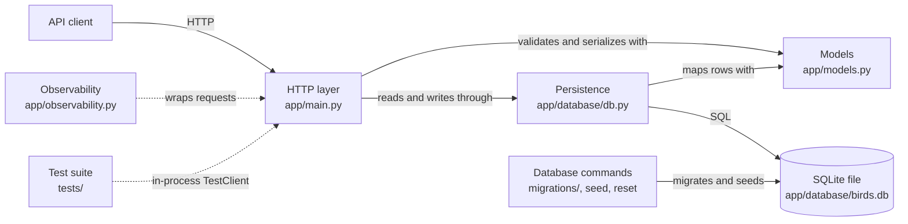
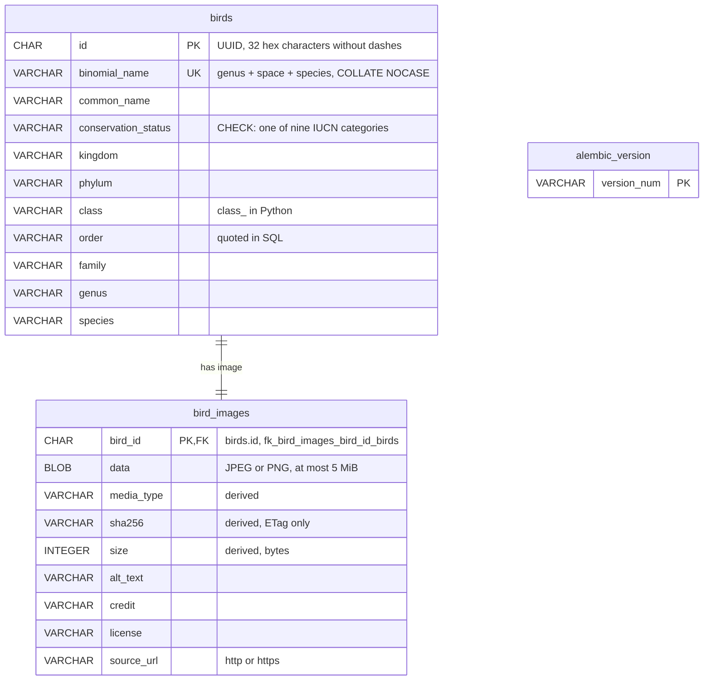

# Bird API Architecture

## Overview

Bird API is a small, single-process REST service. It lists, reads, and creates bird records, including taxonomic data and an image, in a local SQLite database.

The application is a modular monolith with three main parts:

1. A FastAPI HTTP layer with versioned `/api/v1/birds` routes.
2. SQLModel data models: two database table models (birds and their images), plus separate request and response models that define the public API.
3. A SQLAlchemy/SQLite persistence layer that provides one database session per request.

There are no external services, background workers, caches, or frontend components.

## Technology stack

| Area | Technology |
|---|---|
| Language | Python 3.13 |
| HTTP framework | FastAPI |
| ASGI server | Uvicorn, through FastAPI's standard tooling |
| Data modeling | SQLModel and Pydantic |
| ORM and database access | SQLAlchemy |
| Database | SQLite |
| Schema migrations | Alembic |
| Dependency management | `uv` |
| Tests | pytest and FastAPI `TestClient` |
| Linting and formatting | Ruff |
| Type checking | mypy, strict, with the pydantic plugin |
| Local git hooks | pre-commit, with local hooks only |

## Architecture diagram



## Components

### `app/main.py`: HTTP layer

This module creates the `FastAPI` application and calls `setup_observability()` from `app/observability.py`. Bird routes live on an `APIRouter` with the prefix `/api/v1/birds`. Health routes live on a separate `APIRouter` with the prefix `/health`, which stays unversioned at the root. Both routers are included in the app.

| Route | Success | Errors | Behavior |
|---|---|---|---|
| `GET /health/live` | `200` | none | Liveness check. Returns `{"status": "ok"}` without accessing the database. |
| `GET /health/ready` | `200` | `503` `{"status": "unavailable"}` when the query raises a SQLAlchemy error | Readiness check. Runs `SELECT 1` through `SessionDep` and returns `{"status": "ok"}` when the database answers. |
| `GET /api/v1/birds` | `200` | `422` for invalid `offset`, `limit`, `sort`, or `conservation_status` | Returns a `BirdPage`: `{"items": [...], "total": <int>, "offset": <int>, "limit": <int>}`. `total` counts the birds that match the filters, ignoring `offset` and `limit`. Optional exact-match filters, combined with AND: `conservation_status` (a `ConservationStatus` value), `kingdom`, `phylum`, `class`, `order`, `family`, and `genus`. `sort` is one of `common_name` (default), `binomial_name`, `conservation_status`, `family`, or `genus`, with a leading `-` for descending; `id` ascending always breaks ties. `offset` defaults to `0` (minimum `0`); `limit` defaults to `100` (between `1` and `100`). Birds without a `bird_images` row are left out of `items` and `total`. |
| `GET /api/v1/birds/{bird_id}` | `200` | `404` `{"detail": "Bird not found"}`, also for a bird without a `bird_images` row; `422` for a malformed UUID | Returns one bird. |
| `GET /api/v1/birds/{bird_id}/image` | `200`; `304` when `If-None-Match` matches the `ETag` | `404` `{"detail": "Bird not found"}` when there is no `bird_images` row for the id; `422` for a malformed UUID | Returns the raw image bytes with the stored `media_type` as `Content-Type`, `ETag: "<sha256>"` (strong), and `Cache-Control: public, max-age=86400`. `If-None-Match` matches when it contains the ETag (a `W/` prefix is ignored, and a comma-separated list or `*` is accepted). A `304` has no body and keeps both headers. The OpenAPI schema lists `image/jpeg` and `image/png` for `200`. |
| `POST /api/v1/birds` | `201` | `409` `{"detail": "A bird with this binomial_name already exists"}`; `422` for a missing field or a value that breaks a `BirdCreate` rule (see [`app/models.py`](#appmodelspy-bird-models)) | Creates a bird and its image row in one transaction with a server-generated UUID and returns the bird. Any `id`, `image_media_type`, `image_sha256`, or `image_size` sent by the client is ignored; the server derives them. |
| `GET /docs` | `200` | none | Serves FastAPI's interactive API documentation. |
| `GET /openapi.json` | `200` | none | Serves the generated OpenAPI schema. |

The route functions are synchronous. FastAPI runs synchronous endpoints in a thread pool, which works well with the blocking SQLAlchemy calls used by this application.

The old `GET /health` route was removed and now returns `404`.

### `app/observability.py`: request IDs, logging, and errors

`setup_observability(app, log_level)` adds an HTTP middleware and an exception handler to the app, and configures the app's loggers. It uses only the standard library `logging` module.

Request IDs:

- The middleware reads the incoming `X-Request-ID` header. When the header is absent or empty, it generates a new UUID4.
- It stores the id on `request.state.request_id` for use during the request.
- It returns the id in the `X-Request-ID` response header on every response, including `404`, `422`, `503`, and `500` responses.

Request logging:

- The middleware writes one `INFO` line per request on the `bird_api.request` logger, in `key=value` format:

  ```text
  2026-10-19 15:44:35,935 INFO bird_api.request request_id=abc123 method=GET path=/api/v1/birds/00000000-0000-0000-0000-000000000000 status=404 duration_ms=2.94
  ```

- `duration_ms` is the time from the start of the middleware to the response, measured with `time.perf_counter()`.
- When a route raises an unhandled exception, the line is still written, with `status=500`.

Logger configuration:

- `configure_logging()` sets the level of the `bird_api` logger from `settings.log_level` and adds one `StreamHandler` (stderr) to it. Calling it again does not add another handler.
- The root logger and the Uvicorn loggers are not changed. Uvicorn's own access and error logs continue to print as before.
- `bird_api` records also propagate to the root logger, so pytest's `caplog` can capture them. If something else adds a handler to the root logger, those lines print twice.

Error handling:

- An exception handler for `Exception` returns `500` with `{"detail": "Internal server error", "request_id": "<id>"}` and the `X-Request-ID` header. It logs the exception at `ERROR` on the `bird_api` logger, with the traceback and the request id.
- `HTTPException` responses (for example `404` `{"detail": "Bird not found"}`) and `422` validation responses keep FastAPI's default format.
- Starlette re-raises the exception after it sends the `500` response. Uvicorn therefore also logs its own `Exception in ASGI application` traceback, which does not contain the request id.

### `app/models.py`: Bird models

The module defines the `ConservationStatus` and `BirdSort` enums, the `detect_image_media_type()`, `build_bird()`, and `build_bird_public()` functions, and these model classes:

| Class | Role |
|---|---|
| `ConservationStatus` | `StrEnum` of the nine IUCN Red List categories. The values are the full names, for example `Least Concern`. |
| `BirdSort` | `StrEnum` of the list sort values: `common_name`, `binomial_name`, `conservation_status`, `family`, and `genus`, each also with a leading `-` for descending. |
| `BirdBase` | Shared taxonomy fields: `conservation_status` (type `ConservationStatus`), the `class` alias, and the other taxonomy names. Not a table. |
| `BirdImage` | SQLModel table model for `bird_images`: `bird_id` (primary key and foreign key to `birds.id`), `data`, `media_type`, `sha256`, `size`, `alt_text`, `credit`, `license`, and `source_url`. Used only inside the application. |
| `Bird` | `BirdBase` plus `id` and the one-to-one relationship `image` (a `BirdImage`); the SQLModel table model for `birds`. Used only inside the application and never exposed in the API schema. |
| `BirdAttributionBase` | `BirdBase` plus the flat API fields `image_alt_text`, `image_credit`, `image_license`, and `image_source_url`. Not a table. |
| `BirdPublic` | `BirdAttributionBase` plus `id`, `image_media_type`, `image_size`, and the computed `image_url` (`/api/v1/birds/{id}/image`); the response body for every bird JSON route. It has no `image` or `image_sha256`. |
| `BirdCreate` | `BirdAttributionBase` plus `image`, without `id` or derived image fields; the request body for `POST`. It applies the input rules below. |
| `BirdPage` | The list response: `items` (a list of `BirdPublic`), `total`, `offset`, and `limit`. |
| `BirdFilters` | The optional list filters, each defaulting to `None`: `conservation_status` (type `ConservationStatus`), `kingdom`, `phylum`, `class_` (query parameter `class`), `order`, `family`, and `genus`. Its fields define which query parameters are filters. |
| `BirdPageQuery` | `BirdFilters` plus `sort` (type `BirdSort`, default `common_name`), `offset` (default `0`, minimum `0`), and `limit` (default `100`, between `1` and `100`). The list route reads all its query parameters into it. FastAPI flattens a query model into separate parameters only when it is the route's only query parameter, so the pagination and sort fields are on this model too. |

`detect_image_media_type(data)` returns `"image/jpeg"` when `data` starts with `FF D8 FF`, `"image/png"` when it starts with `89 50 4E 47 0D 0A 1A 0A`, and otherwise `None`.

`build_bird(bird_create, bird_id)` is the only place that turns a validated `BirdCreate` into stored objects: a `Bird` with the given `id` and its `BirdImage`. It copies the image bytes to `data` and the four `image_*` attribution fields to `alt_text`, `credit`, `license`, and `source_url`. It derives `media_type` with `detect_image_media_type()`, `sha256` as the lowercase hex SHA-256 of the bytes, and `size` as the byte count. `create_bird()` and the seed loader both use it, so API and seed rows are built the same way.

`build_bird_public(bird)` flattens a `Bird` and its loaded `BirdImage` into `BirdPublic`, mapping `media_type`, `size`, and the attribution columns back to the `image_*` names. It does not read `data` or `sha256`.

`BirdCreate` input rules (each failure returns `422`):

- `conservation_status` must be one of the nine `ConservationStatus` values, matched exactly. The OpenAPI schema lists them.
- Every text field (all fields except `conservation_status`, `image`, and `image_source_url`) has surrounding whitespace removed, and must then have 1 to 200 characters.
- `genus` must match `^[A-Z][a-z]+$`. `species` must match `^[a-z]+(-[a-z]+)*$`, so a hyphenated epithet such as `novae-hollandiae` is allowed.
- `binomial_name` must equal `genus`, one space, and `species`. The error message gives the expected value.
- `image` must be valid base64. The decoded bytes must be at most 5 MiB (5,242,880 bytes) and must be a JPEG or PNG, as `detect_image_media_type()` detects.
- `image_alt_text`, `image_credit`, and `image_license` are required text fields.
- `image_source_url` is required, has surrounding whitespace removed, and must be an `http` or `https` URL of at most 2000 characters, validated by Pydantic's `HttpUrl`. It is stored as the normalized string, so a bare host gets a trailing `/`.

Only the enum is on `BirdBase`, because the database CHECK constraint guarantees that every stored row has a valid status. The other rules are only on `BirdCreate`, because no database constraint enforces them. If `BirdPublic` applied them, a stored row that breaks a rule (for example, one inserted with the SQLite CLI) would make reads fail with `500`.

The query functions work with `Bird` and `BirdImage`. The JSON route handlers convert each `Bird` with `build_bird_public()` and return `BirdPublic`, or `BirdPage` for the list, and each route declares that `response_model`. The OpenAPI schema therefore contains `BirdCreate`, `BirdPublic`, `BirdPage`, and the `ConservationStatus` and `BirdSort` enums, but no table model.

`BirdCreate` exists because SQLModel table models skip validation when constructed directly, and because clients must not choose the `id` or the derived image fields. `create_bird()` calls `build_bird()` with a new `uuid4()`.

All fields are required and cannot be `None`, matching the database constraints.

Important mappings:

- `id` is a Python `UUID` and the primary key of `birds`. `BirdImage.bird_id` has the same type and is the primary key of `bird_images`, so a bird has at most one image row.
- `bird_images.bird_id` references `birds.id` through the named constraint `fk_bird_images_bird_id_birds` in `BirdImage.__table_args__`.
- `binomial_name` is unique through the named constraint `uq_birds_binomial_name` in `Bird.__table_args__`, so `SQLModel.metadata` matches the migrations. The column uses SQLite's `NOCASE` collation, so the constraint treats names that differ only in case as duplicates, even for rows written outside the API. Stored names keep the case they were written with.
- `conservation_status` uses a non-native SQLAlchemy `Enum` that stores the full-name value (not the member name) as text and loads it back as a `ConservationStatus` member. The named CHECK constraint `ck_birds_conservation_status` in `Bird.__table_args__` limits the column to the nine values.
- `class_` is the Python attribute for the database and JSON field named `class`, because `class` is a Python reserved word.
- `validate_by_name=True` allows Python code to construct a bird with `class_=...` while API and database input can use `class`.
- `BirdImage.data` is stored and handled internally as `bytes`. It is accepted as base64 in `BirdCreate.image` on `POST` and returned only as raw bytes by the image route, never in JSON.
- `order` is a normal Python field; the database column is quoted in SQL because `order` is a SQL reserved word.

### `app/database/db.py`: persistence layer

This module owns database infrastructure and queries:

- Creates one process-wide SQLAlchemy `engine` at import time from `settings.database_url` (see [Configuration and runtime](#configuration-and-runtime)).
- Sets `check_same_thread=False`, allowing sessions to be used by FastAPI's endpoint threads.
- Calls `enable_foreign_keys(engine)` from `app/database/sqlite.py`, a module that creates no engine so the reset command can import it safely. It adds a SQLAlchemy `connect` event listener that runs `PRAGMA foreign_keys=ON` on every new connection of that engine. SQLite ignores foreign keys unless this is set per connection. It is called for the app engine, the reset command's seeding engine, and the tests' in-memory engines. Alembic's engine in `migrations/env.py` does not use it, so foreign keys stay off while migrations rebuild tables in batch mode.
- Provides `get_session()`, a FastAPI dependency that opens a session for a request and closes it afterward.
- Exposes that dependency as `SessionDep` for endpoint signatures.
- Implements the queries used by the routes:
  - `select_birds_with_image_metadata()` is the shared base statement of the JSON queries. It selects `Bird` with an explicit `JOIN bird_images` and `contains_eager(Bird.image).defer(BirdImage.data)`, so one `SELECT ... JOIN bird_images` loads every bird with its image metadata but without the `data` column, and leaves out birds that have no image row. Because the join is part of the statement and not of a loader option, a `COUNT` built from the statement applies it too.
  - `get_bird_page(session, query)` adds one `WHERE column = value` per `BirdFilters` field that is not `None` to that statement. From this filtered statement it derives the page query (`ORDER BY <sort column> [DESC], id`, `OFFSET`, and `LIMIT`) and `SELECT count(*) FROM (<filtered statement>)`, and returns the birds and the total.
  - `get_bird(session, bird_id)` filters that statement by `id` and returns `None` when there is no match.
  - `get_bird_image(session, bird_id)` looks a `BirdImage` up by primary key, including `data`, and returns `None` when it does not exist.
  - `create_bird(session, bird_create)` builds the bird and image with `build_bird()` and a new UUID, adds the bird (the relationship cascade adds the image), commits both inserts in one transaction, and returns the stored bird. When the commit raises `IntegrityError` (a duplicate `binomial_name`), it rolls the session back, so no image row remains, and raises `DuplicateBirdError`, which the route turns into `409`.

Application startup does not create, migrate, or seed the database. The schema is managed by Alembic, and seed data is loaded by a separate command.

### `migrations/` and `alembic.ini`: schema migrations

`migrations/env.py` connects to `settings.database_url`, so `BIRD_API_DATABASE_URL` selects the database to migrate. It compares against `SQLModel.metadata` (importing `app.models` to register the tables) and uses `render_as_batch=True`, because SQLite can change constraints only by copying the table. Its engine does not enable foreign keys, because a batch rebuild drops and recreates `birds` while `bird_images` references it.

| Revision | Purpose |
|---|---|
| `3744c2fc21ed` | Baseline. Creates the `birds` table with the columns and types of the `Bird` model. |
| `3453d99012b6` | Adds the unique constraint `uq_birds_binomial_name` in batch mode. |
| `891a7254d1d7` | Adds the CHECK constraint `ck_birds_conservation_status` in batch mode. The upgrade fails if an existing row has a status that is not one of the nine values. |
| `c1acf131e21c` | Adds the seven image metadata columns. Existing rows get `image_media_type`, `image_sha256`, and `image_size` computed from their `image` bytes (with magic-byte detection inline in the migration) and `Unknown` for the four attribution columns. Then all seven become NOT NULL in batch mode. The upgrade fails if an existing image is not a JPEG or PNG. The downgrade drops the columns. |
| `99fdb77b15b5` | Creates `bird_images` (all columns NOT NULL, `bird_id` primary key, foreign key `fk_bird_images_bird_id_birds` to `birds.id`), copies each bird's `image` and seven `image_*` columns into it with `INSERT ... SELECT`, then drops those eight columns from `birds` in batch mode. The downgrade first fails with a `ValueError` that lists the ids of any birds without an image row, then re-adds the eight columns as nullable, copies the values back, makes them NOT NULL in batch mode, and drops `bird_images`. |
| `f361dc9e93e8` | Changes `binomial_name` to `COLLATE NOCASE` in batch mode, so its unique constraint ignores case. The upgrade first fails with a `ValueError` that lists any names that differ only in case, and changes nothing. The downgrade restores the default case-sensitive collation. |

A database that existed before Alembic was brought under it with `alembic stamp 3744c2fc21ed` followed by `alembic upgrade head`.

### `app/database/seed/`: seed data

- `birds.json` holds the `id` and every `BirdCreate` field of each seed bird, including the image attribution, with `image` as a path relative to the seed directory, for example `images/northern-cardinal.jpg`.
- `load_seed_birds()` reads the JSON and image files, validates each record as `BirdCreate`, and returns `Bird` objects with their `BirdImage`, built by `build_bird()`. The seed command and the tests both use it.
- `seed_birds(session)` inserts the seed birds whose `id` is not already in the database, together with their image rows, commits, and returns the number inserted. Running it again is harmless.
- `uv run python -m app.database.seed` runs `seed_birds()` against the configured database.

### `app/database/reset.py`: local database reset

`uv run python -m app.database.reset` rebuilds the database at `settings.database_url` from scratch. `reset_database()` deletes the SQLite file, runs `alembic upgrade head`, and calls `seed_birds()`. `sqlite_database_path()` raises `ValueError` for a URL that is not SQLite or that is an in-memory SQLite database (`sqlite://`, `:memory:`, or `mode=memory`). The command then exits with status `1` and does not delete anything.

### `tests/`: verification

No test reads or writes `app/database/birds.db`. Every test creates the data it needs.

Shared setup:

- `tests/conftest.py` sets `BIRD_API_DATABASE_URL` to a SQLite file in a temporary directory before any `app` module is imported, so the module-level `engine` never points at `birds.db`. The directory is removed when the test session ends. It also defines the `session` fixture, which gives each test a fresh in-memory SQLite database with foreign keys enabled by `enable_foreign_keys()` and tables created by `SQLModel.metadata.create_all()`, and the `client` fixture, a `TestClient` with `get_session` replaced through `app.dependency_overrides`.
- `tests/factories.py` provides `bird_payload()`, a valid `POST` body, and `add_bird()`, which inserts a bird (optionally with a known id such as `CARDINAL_ID`) and its `bird_images` row with a JPEG or PNG `image` and derived metadata into a session. With `image=None` it inserts the bird without an image row.

Test files:

- `tests/test_birds_api.py` tests every bird route through the `client` fixture, including ordering, pagination, `404`, `409` (with no leftover image row), `422`, creation of both rows, each `BirdCreate` input rule, the conservation status enum in the OpenAPI schema, the absence of `image` and `image_sha256` from JSON, server-derived image metadata, the image route's bytes, headers, `304`, `404`, `422`, and OpenAPI media types, and birds without an image row. A `sql_statements` fixture records every statement with a SQLAlchemy `before_cursor_execute` listener. It shows that the list and single-bird routes read `bird_images` but never select its `data` column, that the image route does, and that the list issues one items statement and one `COUNT` statement, both joining `bird_images`, for one bird and for five, with and without filters. The list tests also cover the `BirdPage` envelope, `total` with and without filters and independent of `offset` and `limit`, each filter, combined filters, the `class` and `order` parameter names, each sort field in both directions, the `id` tiebreaker, `422` for an unknown `sort` or `conservation_status`, and the filter, sort, and `BirdPage` entries in the OpenAPI schema.
- `tests/test_main.py` tests `GET /health/live` and `GET /health/ready`, including a `503` when the database query fails.
- `tests/test_observability.py` tests request IDs, per-request log records, the JSON `500` handler, and the `log_level` setting.
- `tests/test_models.py` tests required fields of `Bird` and `BirdImage`, the `class` alias, UUID parsing, `build_bird_public()` serialization without the image, `build_bird()`, the `ConservationStatus` values, and `detect_image_media_type()`.
- `tests/test_config.py` tests the default `database_url`, its `BIRD_API_DATABASE_URL` override, and that the settings and engine used during tests do not point at `birds.db`.
- `tests/test_db.py` tests that the engine uses `settings.database_url` from any working directory, and tests reads, UUID lookup, stored UUID format, non-nullable columns in both tables, that `birds` has no image columns, foreign key enforcement on the app engine and the test engine, the image query, birds without an image row, duplicate `binomial_name` handling, conservation status storage, and the CHECK constraint against an isolated database seeded by each test.
- `tests/test_migrations.py` runs Alembic on temporary database files. It checks that `upgrade head` matches `SQLModel.metadata`, adds the unique constraint and the same CHECK constraint as the model, creates `bird_images` with its primary key and named foreign key, leaves only taxonomy columns in `birds`, and records the head revision; that the baseline creates the original table; that the image metadata revision backfills existing JPEG and PNG rows, fails on other images, and is removed by downgrading it; that upgrading from `c1acf131e21c` copies every image and metadata value unchanged with a clean `PRAGMA foreign_key_check`; that downgrading restores the old NOT NULL columns and values, and fails without changes when a bird has no image row; that head rejects names that differ only in case, the case revision fails on existing case-only duplicates, and its downgrade makes the constraint case-sensitive again; that downgrading to `3453d99012b6` removes the CHECK constraint and keeps rows; that `downgrade base` works; and that a stamped pre-Alembic database upgrades without losing rows.
- `tests/test_reset.py` tests that the reset creates a migrated and seeded database, removes existing rows and tables, replaces a file that is not a database, and refuses non-SQLite and in-memory URLs, both as a function and as a command.
- `tests/test_seed.py` tests the seed files, the cardinal's attribution and derived image metadata, and that they satisfy the `BirdCreate` rules, and runs the seed command twice against a migrated temporary database, comparing both the bird and image rows.

`tests/conftest.py` also provides `alembic_config`, which points `settings.database_url` at a temporary file, and `migrated_engine`, an engine for that file after `upgrade head`.

## Request flows

### `GET /api/v1/birds`

1. FastAPI matches the request to `get_birds()` and validates the query parameters as a `BirdPageQuery`, mapping `class` to `class_`. An invalid `offset`, `limit`, `sort`, or `conservation_status` returns `422` before any database work. Unknown query parameters are ignored.
2. FastAPI resolves `SessionDep` by calling `get_session()`, which opens a SQLModel `Session` from the shared engine.
3. `get_bird_page()` runs one `SELECT ... FROM birds JOIN bird_images ... WHERE <filters> ORDER BY <sort>, id LIMIT ? OFFSET ?` that selects every `bird_images` column except `data`, then one `SELECT count(*)` over the same join and filters. Birds without an image row are not returned or counted.
4. SQLModel converts each row into a `Bird` with its `BirdImage` already loaded, so no further query runs.
5. The route converts each `Bird` into `BirdPublic` with `build_bird_public()` and returns them in a `BirdPage` with the total and the request's `offset` and `limit`.
6. Pydantic serializes the `BirdPage` to JSON. Each item exposes `class` instead of `class_` and adds `image_url`. The image bytes and `image_sha256` are not included.
7. FastAPI closes the session after the response is produced.

### `GET /api/v1/birds/{bird_id}`

1. FastAPI parses `bird_id` as a UUID; a malformed value returns `422`.
2. `get_bird()` runs the same joined `SELECT`, without `data`, filtered by `id`.
3. A missing bird, or a bird without an image row, raises `HTTPException(404, "Bird not found")`; otherwise the bird is serialized as above.

### `GET /api/v1/birds/{bird_id}/image`

1. FastAPI parses `bird_id` as a UUID (a malformed value returns `422`) and reads the optional `If-None-Match` header.
2. `get_bird_image()` loads the `bird_images` row by primary key, including `data`. It does not read `birds`. A missing row returns `404 {"detail": "Bird not found"}`.
3. The route builds the strong ETag `"<sha256>"` and `Cache-Control: public, max-age=86400`.
4. When `If-None-Match` matches the ETag, the route returns `304` with no body. Otherwise it returns `200` with `data` and `Content-Type` set to `media_type`.

### `POST /api/v1/birds`

1. FastAPI validates the JSON body as `BirdCreate`. Missing fields, `null` values, or values that break a `BirdCreate` input rule return `422`.
2. `create_bird()` calls `build_bird()`, which builds a `Bird` and its `BirdImage` from the validated data with a new `uuid4()` as `id`, and derives `media_type`, `sha256`, and `size` from the image bytes.
3. The session inserts the `birds` row and then the `bird_images` row, commits both in one transaction, and refreshes the bird from the database. If the `binomial_name` already exists, the session is rolled back, no image row is left, and the route returns `409`.
4. The route converts the stored bird with `build_bird_public()`, and FastAPI returns `201 Created` with it, including its generated `id` and `image_url`.

## Data architecture

The database contains the `birds` table, the `bird_images` table with one row per bird, and Alembic's `alembic_version` table, which holds the current revision id.



Every column is NOT NULL. `id` is exposed in JSON in standard dashed UUID form. The JSON fields `image_media_type`, `image_size`, `image_alt_text`, `image_credit`, `image_license`, and `image_source_url` come from the `bird_images` columns without the `image_` prefix. `data` and `sha256` never appear in JSON; the image is served as raw bytes by `GET /api/v1/birds/{bird_id}/image`, and accepted as base64 in `image` on `POST`.

The server derives `media_type`, `sha256`, and `size` on `POST` and ignores client values for them. Rows that existed before revision `c1acf131e21c` have `Unknown` in the four attribution columns.

On `POST`, every text column is also stripped of surrounding whitespace and limited to 1 to 200 characters (2000 for `image_source_url`). These limits are checked only by the API, not by the database.

The foreign key from `bird_images.bird_id` to `birds.id` is enforced because the app engine enables `PRAGMA foreign_keys=ON`; it has no `ON DELETE` action. Nothing in the database requires a bird to have an image row; the API treats a bird without one as not found. There are no indexes beyond the primary keys, the unique constraint, and the CHECK constraint.

## Configuration and runtime

`app/config.py` defines a `pydantic-settings` `Settings` class and a module-level `settings` instance. Settings are read from environment variables with the `BIRD_API_` prefix:

| Environment variable | Default | Purpose |
|---|---|---|
| `BIRD_API_DATABASE_URL` | `sqlite:///` + the absolute path of `app/database/birds.db` | SQLAlchemy URL used to create the engine. |
| `BIRD_API_LOG_LEVEL` | `INFO` | Level of the app's `bird_api` loggers, for example `DEBUG` or `WARNING`. It does not change the root or Uvicorn loggers. |

The default path is resolved relative to `app/config.py`, so it does not depend on the working directory used to start the server. There is no `.env` file support.

Other configuration is fixed in code:

- The application title is `Bird API`.
- Dependencies and Python tooling are declared in `pyproject.toml` and locked in `uv.lock`.

No production deployment, process manager, container, or hosting configuration is defined yet.

## Single-machine runtime

The whole application runs on one machine with no separate servers. Commands are in [README.md](README.md).

- **One process.** Uvicorn, FastAPI, the models, and the database code all run in one Python process. Uvicorn listens on `localhost:8000`, so only programs on the same machine can reach it. In development mode, a parent process watches the source files and restarts this process when they change.
- **The database is a library, not a server.** SQLite runs inside the Python process. Each query reads or writes `app/database/birds.db` directly through the file system; no network or database server is involved. Images are stored in the same file.
- **Threads within the process.** The route functions are synchronous, so FastAPI runs each request on a worker thread. Each request gets its own session and SQLite connection from the shared engine. SQLite allows many readers but only one writer at a time, so concurrent writes wait on a file lock.
- **No in-memory state.** Bird data is not cached. Every request reads the file, so a change made through the SQLite CLI is visible to the next request. Data remains in the file after the process stops.
- **Separate short-lived commands.** Alembic, the seed command, and the reset command are separate processes that open the same file, do their work, and exit. Startup does not run them.
- **Tests use no network.** pytest calls the app with `TestClient` inside the test process, without Uvicorn or a port. Each test gets its own in-memory SQLite database, and migration tests use temporary files, so tests never touch `birds.db`.

## Key design decisions

### Separate table, request, and response models

`BirdBase` holds the taxonomy field definitions once. `Bird` adds the database identity, `BirdCreate` defines what a client may send, and `BirdPublic` defines what a client receives. Because the API is defined by `BirdCreate` and `BirdPublic` rather than the table models, a column added to `Bird` or `BirdImage` (for example, internal metadata) does not appear in responses unless it is also added to `BirdPublic`.

`BirdPublic` and `BirdCreate` keep the flat `image_*` fields through `BirdAttributionBase`, so the API did not change when the image moved to its own table. `build_bird()` and `build_bird_public()` are the only places that map between the flat API fields and the `bird_images` columns. `BirdPublic` adds the computed `image_url` and has no `image` or `image_sha256`. `BirdCreate` omits the derived image fields. All three inherit from `BirdBase`, so a taxonomy field added to the base appears in requests, responses, and the `birds` table.

### Versioned routes

All bird routes are under `/api/v1`, so a future incompatible change can ship as `/api/v2` without breaking existing clients. The `/health/live` and `/health/ready` routes stay unversioned because infrastructure checks should not move between versions.

### Separate liveness and readiness

Liveness does not touch the database, so a database outage does not make an orchestrator restart a process that is otherwise healthy. Readiness runs `SELECT 1`, so traffic can be held back while the database cannot answer.

### Offset pagination with a stable order

`offset`/`limit` pagination is simple and matches SQL directly. The list returns an envelope with `items`, `total`, `offset`, and `limit`, so a client can tell how many pages there are. The page query and the `COUNT` query are derived from the same filtered statement, so `total` always uses the same filters and join as `items`. The cost is a second query per request.

Filters are exact matches combined with AND. They use each column's collation, so they are case-sensitive; `binomial_name` has `NOCASE` but is not a filter. A client chooses one sort field from a fixed allowlist, with a leading `-` for descending. `id` ascending is always added as the last sort key, so pages are deterministic even when values repeat. The allowlist is the `BirdSort` enum, so the OpenAPI schema lists the values and unknown fields return `422`. `conservation_status` sorts by its stored text, alphabetically, not by IUCN severity. Sorting by `binomial_name` ignores case because of its `NOCASE` collation.

Offset pagination can skip or repeat rows if data changes between page requests, and becomes slower at very large offsets; cursor pagination would address both if needed. There are no indexes for the filter or sort columns, which is acceptable for a small dataset.

### SQLite and a local database file

SQLite keeps setup minimal and requires no database server. It is suitable for local development and a small dataset. The trade-off is limited write concurrency, no network access to the database, and persistence tied to the machine or deployment filesystem.

### Images stored as blobs in a separate table

Images are stored in SQLite, so the database file holds all bird data. Base64 would increase image payload size by roughly one third, and including images made every list response carry up to 100 full images. JSON responses therefore contain only `image_url` and public metadata, and `GET /api/v1/birds/{bird_id}/image` serves the raw bytes. The SHA-256 ETag and one-day public `Cache-Control` let clients and caches reuse an image and revalidate it with a `304`. Base64 is still used for the image in the `POST` body.

The image and its metadata are in `bird_images`, not in `birds`, so `birds` holds only bird and taxonomy data. When the blob was a column of `birds`, SQLite had to walk the blob's overflow pages to reach the metadata columns after it, and the JSON queries loaded the blob without using it. Now the JSON routes join `bird_images` and defer `data`, so they read the metadata but never the blob, in one statement for any page size. `bird_id` is both the primary key and the foreign key, so there is at most one image per bird.

### Session per request

The shared engine is safe to reuse across requests, while each request receives its own session. This avoids sharing session state and replaces the earlier shared connection and cursor approach.

### Schema managed by Alembic, data seeded from files

Alembic migrations in the repository define the schema, and `app/database/seed/` holds the canonical seed data, so the full database can be rebuilt from git. `birds.db` is no longer committed. Migrations and seeding run as explicit commands, not at startup, which keeps startup simple. A test checks that the migrated schema matches `SQLModel.metadata`, so the models and migrations cannot drift apart unnoticed. The tests' in-memory databases still use `create_all()` for speed.

## Current limitations and natural next steps

- There are no update or delete routes.
- There is no search or field selection in list responses.
- `binomial_name` uniqueness ignores case only for ASCII letters, because SQLite's `NOCASE` collation does not fold other characters. Scientific names use ASCII letters.
- The text field rules (whitespace, length, and taxonomy name format) are checked only on `POST`, not by the database.
- `POST` checks only the leading magic bytes and the decoded size of `image`. It does not decode the image, so a file with a valid header but corrupt content is accepted.
- The database does not require each bird to have a `bird_images` row. The API always inserts both, but a bird inserted without one (only possible with direct SQL) is left out of the list and returns `404` from the single-bird and image routes. The downgrade from `99fdb77b15b5` refuses to run while such a bird exists.
- Foreign keys are enforced only on connections that run `PRAGMA foreign_keys=ON`: the app engine, the reset command's seeding engine, and the test engines. The SQLite CLI and the Alembic engine do not enforce them.
- Birds that existed before revision `c1acf131e21c` have `Unknown` attribution, and there is no update route to correct it.
- In the OpenAPI schema, `BirdCreate.image` is described as a generic binary string rather than base64 text.
- There is no authentication, authorization, CORS configuration, or rate limiting.
- Only unhandled exceptions use the custom JSON error body with `request_id`. `HTTPException` and `422` responses keep FastAPI's default format and do not contain the request id in the body, only in the `X-Request-ID` header.
- Observability is limited to request ids, one log line per request, and error logs. There are no metrics, tracing, or log shipping. Log lines are `key=value` text, not JSON.
- Migrations and seeding are not run automatically; each environment must run them before starting the app.
- The seed command only inserts missing ids. It does not update a seed bird that was changed in the database or in `birds.json`.

Natural evolution, when needed, would be to add update and delete routes, search, and object storage for images.

## Still to do

- **Allow birds without an image.** Replace the flat `image_*` fields in `BirdPublic` with one `image` object (`url`, `media_type`, `size`, `alt_text`, `credit`, `license`, `source_url`) that is left out of the JSON when the bird has no image, rather than set to `null`. The list and single-bird routes include birds without an image, and `total` counts them. `GET /api/v1/birds/{bird_id}/image` returns `404` for a bird without an image, so clients can show a blank placeholder.
- **Make the image optional on `POST`.** The base64 `image` and its four attribution fields become optional together: a request sends all of them or none of them.
- **Remove accepted limitations from this document.** `Unknown` attribution for birds that existed before revision `c1acf131e21c` is acceptable. A bird without a `bird_images` row becomes intended behavior once birds without an image are allowed.
- **Update the key design decisions for image storage.** Explain why images stay as blobs in SQLite for now: the dataset is small, the images are small, and the whole app runs on one machine. Describe object storage, such as S3, as the path when scale requires it: store object keys rather than URLs, keep the metadata in `bird_images`, and serve images through pre-signed redirects.
